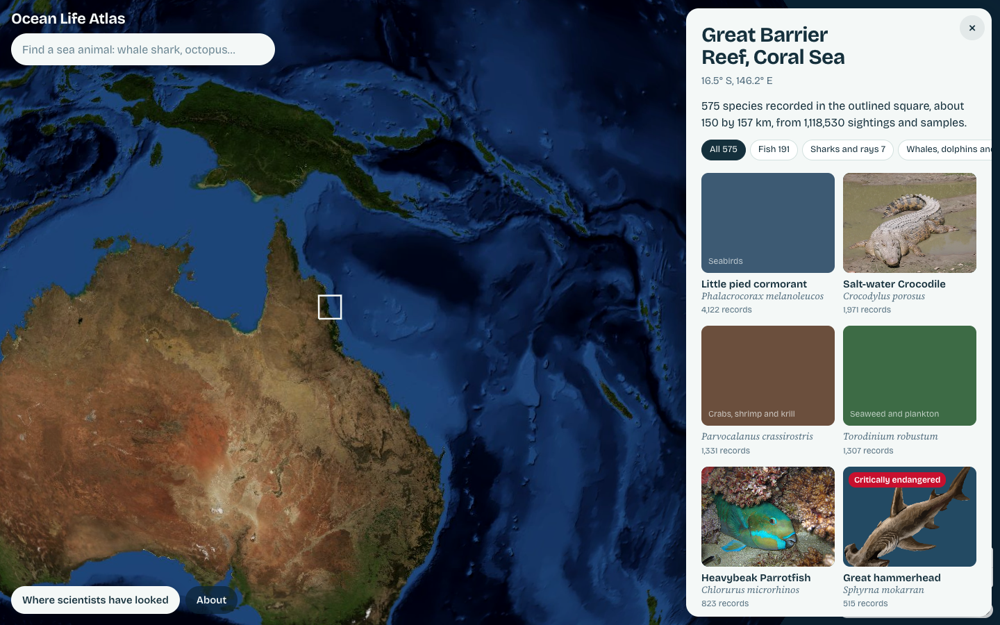
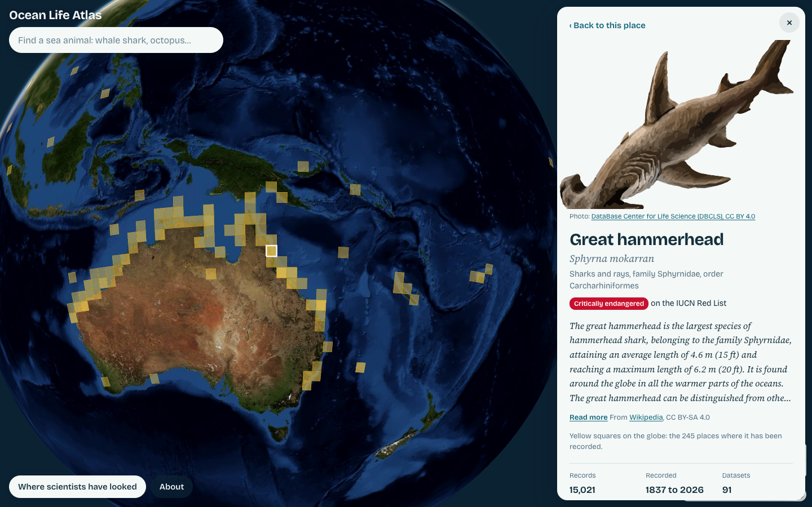
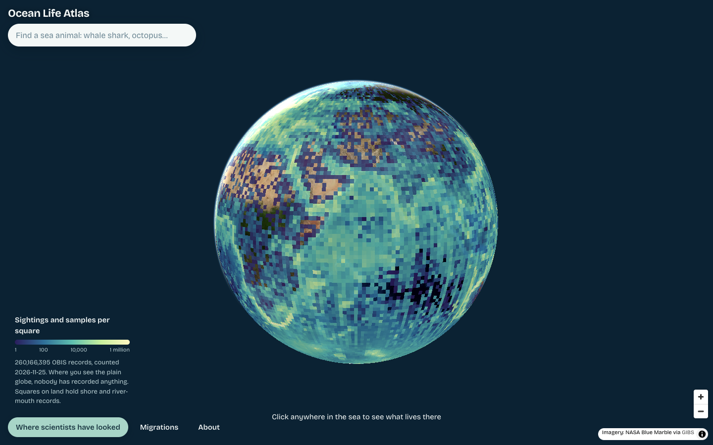
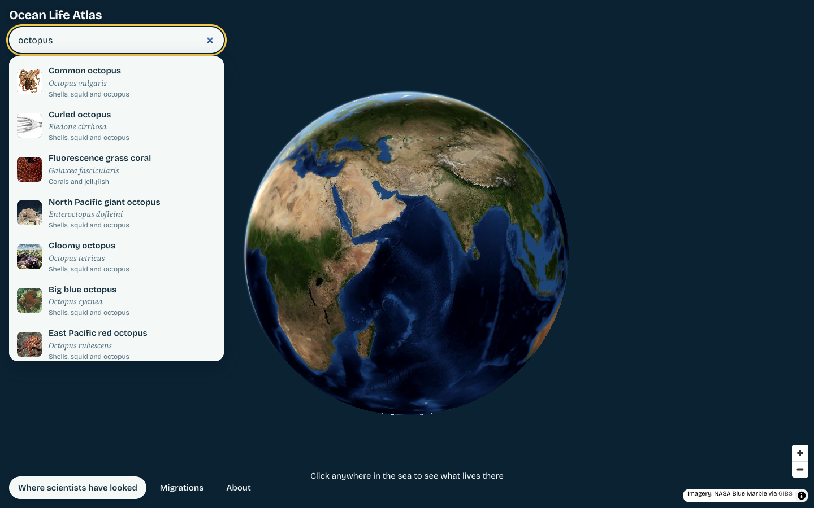
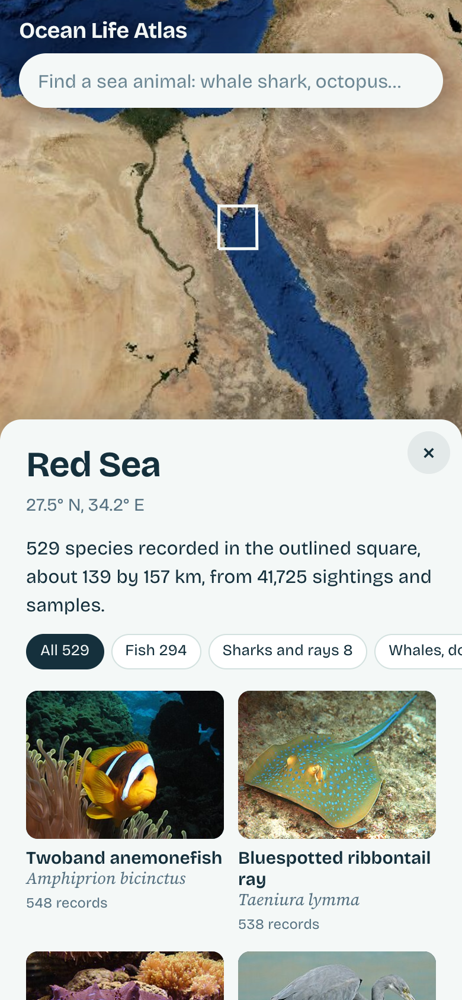

# Ocean Life Atlas

**Click the sea, see who lives there.** An open, plain-language atlas of ocean life on a 3D globe.

**Live: https://oceanlife.bristleconelab.org**

- Click any spot in the ocean: the panel lists every animal and plant recorded within that 1.4° square (about 150 km
  across), with photos, everyday names, Red List status and a filter by kind (fish, sharks and rays, whales and
  dolphins, sea reptiles, seabirds, corals, shells and octopus, crabs, starfish, seaweed and plankton).
- Search any sea animal by its everyday or scientific name ("octopus", "whale shark", *Rhincodon typus*): the globe
  shows every place it has been recorded, and the panel shows a photo, a short summary, how deep it lives and the
  water temperatures it is found in.
- Switch on **Where scientists have looked** to see how unevenly the ocean has been sampled. A short species list
  usually means few people have looked, not that little lives there, and the atlas says so.



| A species page | Where scientists have looked |
|---|---|
|  |  |

| Search by everyday name | On a phone |
|---|---|
|  |  |

Every place and species has its own link, for example
[`#at=-16.50,146.20`](https://oceanlife.bristleconelab.org/#at=-16.50,146.20) (a place) or
[`#sp=105817`](https://oceanlife.bristleconelab.org/#sp=105817) (a species).

## Why

The data already exists: [OBIS](https://obis.org) holds more than 260 million records of where marine species were
seen or sampled. But the tools built on it expect you to know Latin names and filter syntax: the OBIS Mapper opens on
an empty map that only accepts scientific names, AquaMaps is a 2019 site with a small static map, and GBIF's map shows
the whole planet as repeated dots. This atlas asks the two questions a curious person asks, "what lives here?" and
"where does this animal live?", and answers them with pictures and everyday words.

## How it works

The site is static: there is no server, and everything is fetched live by your browser from open services that allow
it.

| Question | Source |
|---|---|
| Which species were recorded in this square, how often, Red List status | OBIS API `checklist` and `statistics` |
| Where a species has been recorded | OBIS API `occurrence/grid` (geohash-3 squares) |
| How deep it lives, surface temperature | OBIS API `statistics/env` (middle 80 % of depth records) |
| Search by everyday name | WoRMS `AphiaRecordsByVernacular`, plus OBIS name completion; ranked by exact name, then by OBIS record count |
| Photo, everyday name in the reader's language, Wikipedia article | Wikidata (WoRMS id, P850) through [QLever](https://qlever.dev), with the Wikidata Query Service as fallback; photo credits from the Commons API |
| Sea name for a point | Marine Regions gazetteer |
| Globe imagery | NASA Blue Marble through GIBS |

The only stored data is `public/data/records-gh3.json` (184 KB): the number of OBIS records in each of 27,204
geohash-3 squares, used by *Where scientists have looked*. Rebuild it with `npm run data` (it takes about 10 s and
checks the cell count).

## Honest limits

- A species list is a record of what was found, not a census. Record counts show where people looked and what they
  looked for: on the Great Barrier Reef the most-recorded species is a cormorant, because bird surveys produce many
  records. The "All" view therefore interleaves kinds of life, most-recorded first within each kind.
- Squares are 1.4° on a side, so a square at the coast also holds shore and river-mouth records; on land the panel says
  so.
- Records with wrong coordinates exist in OBIS and appear as they are.
- Photos and names depend on Wikidata coverage. Where Wikidata has no everyday name, the English name from WoRMS is
  used; where neither exists, the scientific name is shown.

## Data licences

| Data | Licence |
|---|---|
| OBIS records | per dataset, mostly CC BY 4.0 or CC0; cite OBIS (2026) Ocean Biodiversity Information System, Intergovernmental Oceanographic Commission of UNESCO, https://obis.org |
| WoRMS names | CC BY 4.0, WoRMS Editorial Board (2026) World Register of Marine Species, https://www.marinespecies.org |
| Wikidata | CC0 |
| Photos | each file's own licence on Wikimedia Commons, shown with the photo |
| Wikipedia summaries | CC BY-SA 4.0 |
| Marine Regions | CC BY 4.0 |
| NASA Blue Marble | public domain |

Code: MIT (see `LICENSE`).

## Development

```sh
npm install
npm run dev        # http://localhost:5173/ (scripts/screenshots.mjs expects port 5199: npx vite --port 5199)
npm test           # unit tests (geohash, grouping, depth bands, search ranking, names, URL state)
npm run build      # typecheck + production build in dist/
npm run shots      # regenerate docs/img/*.png from a running dev server (needs Google Chrome)
```

Pushes to `main` run the tests, build the site and publish it to Cloudflare Pages (project `ocean-life-atlas`,
`.github/workflows/deploy.yml`). The deploy step needs the repository secret `CLOUDFLARE_API_TOKEN` (Cloudflare
Pages: Edit) and is skipped with a warning without it. Manual deploy: `npm run build && npx wrangler pages deploy dist
--project-name ocean-life-atlas --branch main`.

## Related

[Seafloor Atlas](https://seaflooratlas.org): the same globe idea for the ocean floor, and how much of it has actually
been measured.
